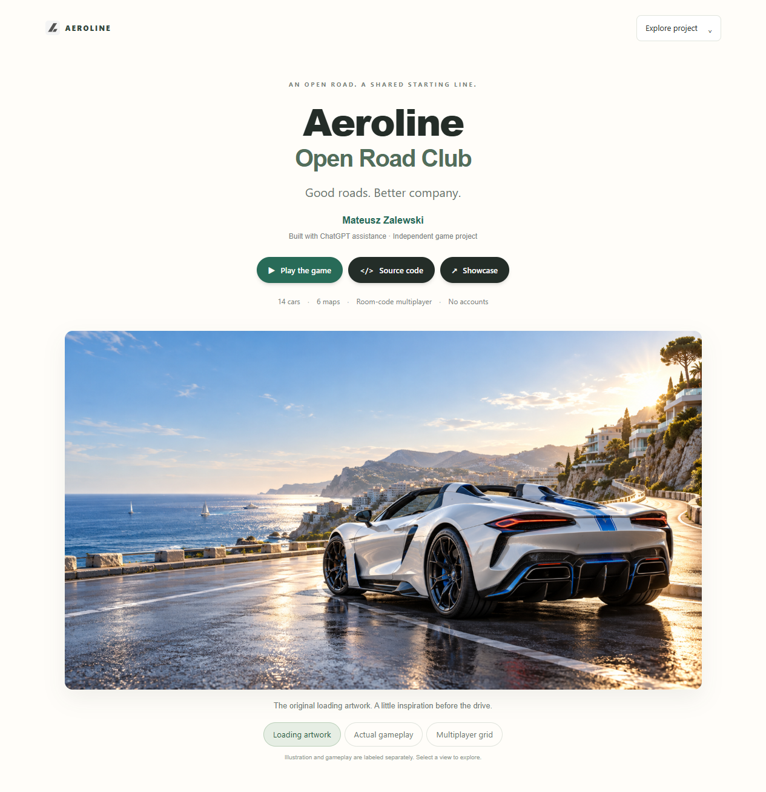
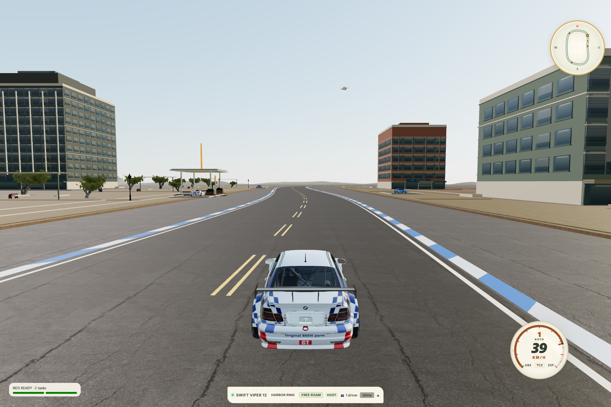
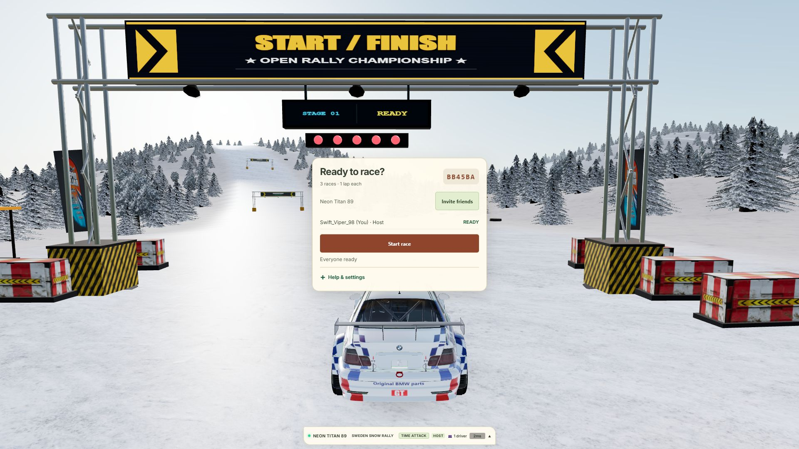
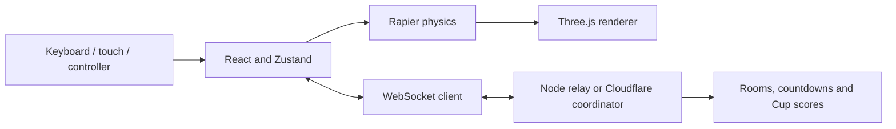

# Aeroline

[**Open the interactive project page →**](https://space-explorer-4231.github.io/afterglow-rally-game/)

[](https://space-explorer-4231.github.io/afterglow-rally-game/)

**A multiplayer browser driving game, built on MIT-licensed OpenRally, with assisted drifting, six maps and room-code races.**

[**Play Aeroline →**](https://aeroline-road-club.aeroline-edge.workers.dev/) · [Report a bug](https://github.com/space-explorer-4231/afterglow-rally-game/issues/new?template=bug_report.yml) · [Suggest an idea](https://github.com/space-explorer-4231/afterglow-rally-game/issues/new?template=feature_request.yml) · [Contribute](CONTRIBUTING.md)

[](LICENSE) [](source/src) [](https://github.com/space-explorer-4231/afterglow-rally-game/actions/workflows/web-checks.yml)

*The project page uses the [Academic Project Page Template](https://github.com/eliahuhorwitz/Academic-project-page-template). Its artwork gallery distinguishes loading illustrations from actual gameplay.*

## Take the wheel

1. Open the [public game](https://aeroline-road-club.aeroline-edge.workers.dev/).
2. Choose **Quick Drive** for an immediate drive, or **Multiplayer** to create a room.
3. Send friends the invite link or six-character code. No player accounts or installation.
4. Choose free driving or a **Club Cup**: three one-lap races, shared starts and points carried between rounds. Follow the gates; most points wins.

Desktop keyboard play is the best-tested experience. Touch and controller support is included; phone usability and performance remain active work.

## On the road

| Drive | Race with friends |
| --- | --- |
|  |  |
| Fourteen cars, distinct handling and fuel-limited boost. | Invite links, ready checks and synchronized countdowns. |

| Action | Keyboard |
| --- | --- |
| Accelerate / brake and reverse | **W / S** or **↑ / ↓** |
| Steer | **A / D** or **← / →** |
| Boost | Hold **Shift** while fuel remains |
| Handbrake | **Space** while turning |
| Camera | **C**; driver-seat view is an optional setting |
| Recover | **R twice**; nearest checkpoint, three-second countdown |
| Pause / settings | **Esc** |

Short, dismissible tips introduce controls one at a time. Countersteering straightens a slide. Recovery can invalidate a competitive run.

<details>
<summary><strong>Explore the six maps</strong></summary>

| Map | Character |
| --- | --- |
| Island Circuit | Coastal hills, mud and grass |
| Desert Canyon | Sand, gravel and canyon roads |
| Sweden Snow Rally | Snow and ice |
| Highland Castle Rally | Technical highland turns |
| Drift District | Industrial tarmac and open drift areas |
| Harbor Ring | Coastal streets and a practice loop |

Experiment with cars and tires, optional weather and driving assists.

</details>

<details>
<summary><strong>How Aeroline was built</strong></summary>

Developed by **Mateusz Zalewski with ChatGPT assistance**, extending **OpenRally by TensorDrift Studio and contributors**. The process combined requirements, playtesting with friends, handling adjustments, interface simplification and public multiplayer deployment. Submitted to Handshake's Create a Multiplayer Game mission.

Built with React, TypeScript, Three.js / React Three Fiber, Rapier and Zustand. A Node WebSocket relay and a Cloudflare Durable Object share race and room logic. Network snapshots run at 20 Hz; rendering and remote-car interpolation run independently.

</details>

## Build and run locally

**Requires Node.js 24+, npm and `tar`.** Editable source lives in [`source/`](source).

```sh
git clone --branch dev https://github.com/space-explorer-4231/afterglow-rally-game.git
cd afterglow-rally-game
node scripts/restore-source-assets.mjs
cd source
npm ci
npm --prefix server ci
npm run build
npm --prefix server run build
npm --prefix server run serve
```

Open **http://localhost:8791/**. Asset preparation verifies the existing deployment archive checksums and restores their runtime assets, then applies the source asset overlay. It does not modify the archives.

For live client editing, keep the relay running and run `npm run dev` in a second terminal inside `source/`. The Vite `/ws` proxy points to port 8791.

Run **`npm run check:web`** inside `source/`. This excludes two Android-packaging suites requiring separate APK artifacts. **`npm run check`** retains the complete suite and reports those failures honestly.

[Development and hosting guide](docs/DEVELOPMENT.md) · [Contributing](CONTRIBUTING.md) · [Security](SECURITY.md)

## Under the hood



- [Client](source/src/components) · [Physics](source/src/utils/physics) · [Cars and maps](source/src/config)
- [Server](source/server/src) · [Cloudflare adapter](source/server/worker) · [Tests](source/tests)
- [Architecture](docs/ARCHITECTURE.md) · [Driving model](docs/DRIVING_MODEL_GUIDE.md) · [Extension guide](docs/EXTENSION_GUIDES.md)

## Help shape the next drive

- [ ] Broader phone and controller testing
- [ ] Smoother frame times in dense scenes
- [ ] More consistent car and environment assets
- [ ] Better connection recovery

These are directions, not promised dates. Reproducible bug reports, documentation and measured performance improvements are welcome. Avoid broad handling changes without a comparison and playtest feedback.

## Status and verification

Source snapshot: **1.38.2**. Root deployment archives retain **1.36.1** for the legacy Node/Render bundle. Asset preparation adds the newer Nightfall mesh for source builds. Check the public game's `/health` endpoint for its current server version.

The recorded 1.38.2 full check had **2,378 passes and ten inherited Android-packaging failures**. Simulation is separate from rendered playtesting. There is no guarantee of zero bugs or 60 FPS on every device. Cloudflare free quotas are finite; hosting does not determine client rendering performance.

## License and credits

**Code is MIT licensed; assets are not all MIT.** Preserve OpenRally's original copyright and license. Aeroline's original code contributions are also MIT licensed.

The template-based project website has its own [CC BY-SA attribution and license](docs/WEBSITE-LICENSE.md); it is separate from the game code license.

Vehicles, textures and recordings retain separate terms. NCS recordings are not public-domain music; game-use permission does not grant blanket redistribution rights. Review or replace restricted media before redistributing a fork.

[Code license](LICENSE) · [Asset credits](ASSET-CREDITS.md) · [Asset licensing guide](docs/ASSET-LICENSING.md)

Loading illustrations are promotional game artwork, not rendered gameplay. Vehicle names do not imply manufacturer endorsement.
